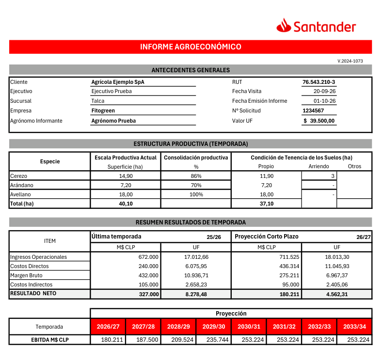
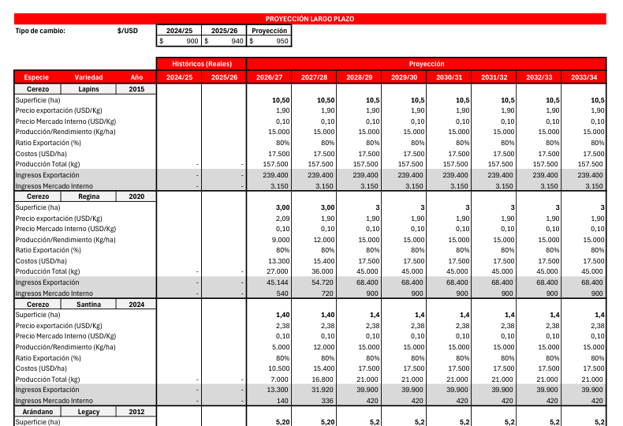
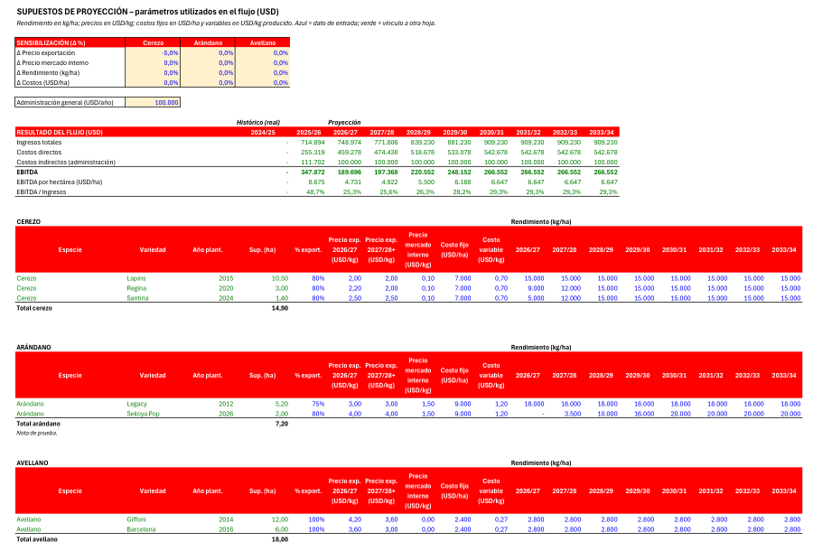

# Generador de informes agrícolas

Sistema que arma los informes agroeconómicos y las tasaciones que una
consultora agrícola entrega a los bancos (Santander y Rabobank), a partir del
catastro de plantaciones del cliente, la visita a terreno y los documentos
legales del predio.

El problema que resuelve: cada informe se hacía a mano en un Excel de 15 hojas
que se copiaba de un cliente a otro. La visita a terreno no es el cuello de
botella; **confeccionar el informe sí**. El sistema lo genera completo, con
**fórmulas vivas** (el banco y el agrónomo pueden cambiar un precio y ver
moverse el EBITDA), y deja al tasador solo el juicio experto.

> Este repositorio es una copia pública del proyecto, sin datos de clientes:
> los informes, escrituras y fotos reales con que se desarrolló no están
> incluidos. Los ejemplos y las pruebas usan datos inventados.



## Qué hace

- **Genera el informe del banco en Excel** sobre el formato oficial, sin
  regenerarlo desde cero: se conserva el diseño, los logos, las listas
  desplegables y las fórmulas. Un bloque de flujo por plantación, una tabla de
  supuestos por especie, el requerimiento de riego por unidad predial… todo se
  repite según el cliente y cada fórmula apunta a la fila que le corresponde.
- **Proyecta la producción a 8 años** con curvas de rendimiento por especie y
  edad (matriz de envejecimiento), precios FOB de ODEPA llevados a retorno al
  productor, y costos fijos y variables.
- **Calcula el requerimiento hídrico** por comuna (ETo), especie (Kc) y sistema
  de riego, contra el caudal disponible.
- **Lee escrituras y certificados del Conservador** (PDF, también escaneados)
  con IA para precargar rol, inscripción y derechos de agua, y cruza los
  documentos para avisar contradicciones.
- **Actualiza tasaciones anteriores** de Rabobank leyendo el Excel o el PDF
  del informe previo.
- **Vista previa** del informe en la página, renderizada con el Excel real.



## Decisiones de diseño

- **80% determinista, 20% IA.** Toda la aritmética, las curvas y la escritura
  del Excel son Python o fórmulas de Excel. La IA solo lee documentos y titula
  fotos; nunca calcula. Y es opcional: sin clave de IA el informe se genera
  igual.
- **Ninguna coordenada de celda en el código.** Dónde va cada dato se declara
  en `config/mapping_*.json`; agregar un formato de banco es agregar un mapping.
- **Partes que se repiten** (`services/disposicion.py`): el formato trae una
  sola vez cada bloque y el generador calcula a qué fila va cada copia y
  reescribe sus fórmulas. Las referencias a otra parte repetida apuntan a la
  copia de su contexto, los rangos se estiran a todas las copias y los totales
  por especie se generan solos.
- **Dos implementaciones, el mismo número.** Las pruebas recalculan el Excel
  generado con Microsoft Excel y comparan el EBITDA de los 8 años contra el
  mismo cálculo hecho en Python.
- **Todo degrada con elegancia:** sin PostgreSQL guarda en JSON; sin Excel
  instalado la vista previa usa LibreOffice.



## Tecnologías

Python 3.11 · FastAPI · Pydantic · openpyxl · SQLAlchemy (async) + PostgreSQL ·
Alembic · Google Gemini (lectura de documentos) · PyMuPDF · Pillow · HTML/CSS/JS
sin framework · automatización de Excel por COM (PowerShell) para el recálculo y
la vista previa.

## Estructura

```
api/        FastAPI: rutas, sesión, seguridad (redes permitidas, CSP, freno de intentos)
services/   motores de Excel, disposición de partes, curvas, riego, precios, IA, armado
schemas/    modelos de dominio (Pydantic)
config/     mappings de cada formato, formulario de visita, parámetros agronómicos
templates/  formatos vacíos de los bancos
web/        la página (una sola, sin framework)
db/         persistencia (SQLAlchemy) · migraciones/ (Alembic)
scripts/    pruebas y utilidades
```

## Cómo correrlo

```bash
python -m venv .venv
.venv\Scripts\activate
pip install -r requirements.txt
copy .env.example .env      # la clave de IA y la base de datos son opcionales
python -m uvicorn main:app --port 8000
```

Y abrir `http://localhost:8000`.

## Pruebas

Cada batería es un script independiente:

```bash
python scripts/test_motor_santander.py   # el generador del formato Santander
python scripts/test_engine.py            # el motor de Excel
python scripts/test_curvas.py            # curvas de producción
python scripts/test_riego.py             # requerimiento hídrico
python scripts/test_seguridad.py         # sesión, redes, cabeceras, CSP
python scripts/validar_mapping.py        # cada mapping contra su plantilla
```

Las que recalculan con Excel real se saltan solas si Excel no está instalado.
